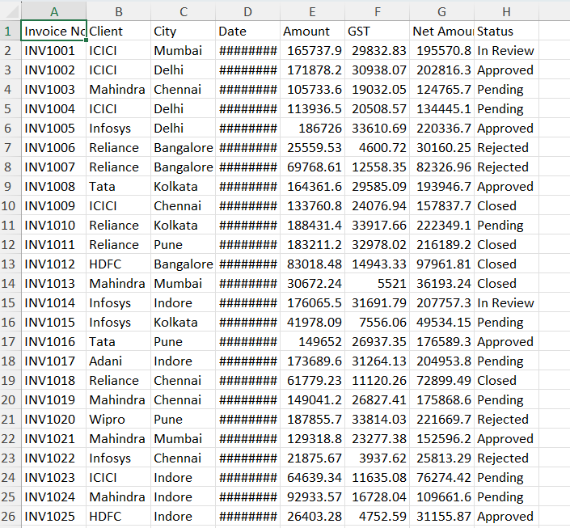
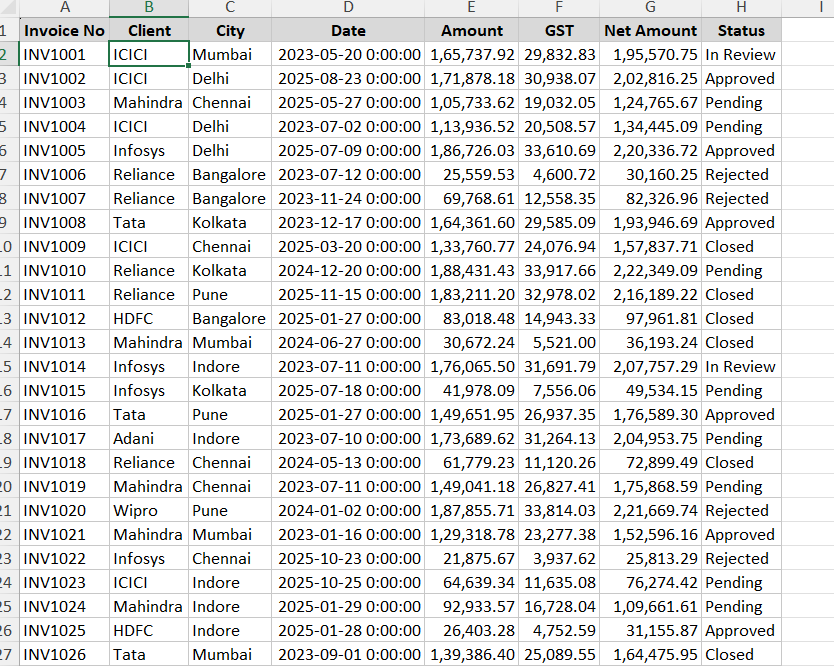

# Workbook Beautification Engine

## Overview

The **Workbook Beautification** tool is an Excel VBA automation utility designed to apply consistent, audit-grade formatting across all populated worksheets in an active workbook.

Instead of manually styling individual sheets, the macro executes across the entire workbook in a single run—adjusting layouts, applying subtle borders, standardizing header rows, and enforcing clean number and percentage formatting.

---

## The Problem

Financial deliverables (management decks, budget reviews, audit schedules) often span multiple worksheets. Inconsistent column widths, raw unformatted numbers, and heavy default gridlines reduce readability and distract decision-makers.

Manual formatting is repetitive, error-prone, and adds friction to tight reporting cycles. This tool provides a one-click automated solution.

---

## Automation Capabilities

For every populated worksheet in the active workbook, the macro:

1. **Auto-Fits Layout:** Adjusts row heights and column widths to fit all content cleanly without truncating text or producing `###` overflow errors.
2. **Applies Subtle Borders:** Replaces default harsh borders with clean, thin light-grey gridlines (`RGB(200, 200, 200)`).
3. **Styles Header Rows:** Formats Row 1 with:
   - Bold typography
   - Professional light-grey background (`RGB(217, 217, 217)`)
   - Centered horizontal and vertical alignment
4. **Smart Numerical Formatting:**
   - Detects percentage metrics and formats them as `0.00%`.
   - Formats general financial numbers with thousands separators and two decimals (`#,##0.00`).
   - Automatically preserves dates and text values without altering them.
5. **Skips Blank Sheets:** Detects empty worksheets automatically to avoid unnecessary processing.

---

## Files Included

| File | Description |
|:---|:---|
| [`BeautifyWorkbook.bas`](BeautifyWorkbook.bas) | Standalone VBA source code module for direct import into any existing Excel workbook. |
| [`WorkbookBeautification.xlsm`](WorkbookBeautification.xlsm) | Pre-configured macro-enabled workbook template ready for immediate use. |
| `Before-Formatting.png` | Sample dataset illustrating unformatted raw numbers. |
| `After-Formatting.png` | Resulting output following macro execution. |

---

## Visual Demonstration

### Before Formatting

### After Formatting

---

## Execution & Performance Optimization

To deliver instant execution across large workbooks, the macro incorporates standard enterprise performance controls:
- **`ScreenUpdating = False`:** Eliminates visual screen flickering and accelerates execution.
- **`Calculation = xlCalculationManual`:** Prevents redundant formula recalculations during formatting passes, switching back to automatic upon completion.
- **`DisplayAlerts = False` & `EnableEvents = False`:** Prevents alert interruptions.
- Displays a clean confirmation dialog when processing completes.

---

## How to Use

1. Open your target financial workbook.
2. Press **Alt + F11** (opens VBA Editor).
3. Go to **File > Import File...** and select `BeautifyWorkbook.bas`.
4. Press **Alt + F8**, select `BeautifyWorkbook`, and click **Run**.
